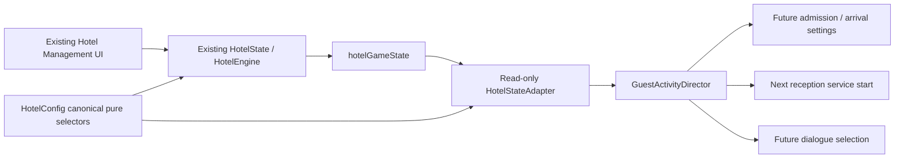

# Phase 5E — management-driven guest activity

The Central Lobby now reads the existing hotel save and presents management
conditions through future guest arrivals, reception pacing and ambient speech.
The hotel engine remains authoritative. No new hotel mechanics, persisted keys,
schema versions, NPC transactions or economic formulas were introduced.

## Data architecture



`hotel/hotel-config.js` owns the unchanged promotion/trait data and pure trait,
coverage, room-capacity and occupancy selectors. Existing `HotelState` getters
delegate to these selectors and retain their previous signatures, slot data,
return shapes and defaults. `HotelGuests` delegates capacity and occupancy to
the same helpers. The engine, payroll, income, satisfaction, staff mutations,
management UI and migrations are unchanged.

The world imports only the pure configuration through `HotelStateAdapter`; it
does not import, initialize or expose HotelState or HotelEngine. The adapter
validates inputs before using canonical calculations, retains one raw string
and one frozen numeric projection, and has no writer API. It never initializes,
migrates, repairs, backs up or saves a hotel. Missing metrics use `available:
false`, null numeric values and a reason. Genuine zero is preserved.

Snapshot sections are `source`, `occupancy`, `reception` and `satisfaction`.
Provenance includes schema version, saved/captured timestamps, presence and
readability. The projected data contains no mutable staff/guest roster or full
hotel object. Each feature falls back independently when its inputs are absent
or unsupported. Known legacy versions 0–9 are read only when the required field
shapes are present; there is no migration. Unknown versions are unavailable.

## Effective mappings

Occupancy uses the dashboard's **guest population / room-upgrade capacity**,
rounded to the same integer percentage. It is aggregate guest-capacity
utilization, not a count of occupied physical rooms. Room levels 1–5 have
capacities **10, 16, 24, 34 and 48**. Neither dirty-room backlog nor roster party
size changes this existing denominator. Over-capacity values, including 200%,
are valid; there is no 100% or 130% presentation clamp.

| Initial utilization | Arrivals | Admission ceiling at configured 6 / 8 | Check-in / casino / relaxing / hotel departure |
| --- | --- | --- | --- |
| Low: below 30% | 30–50 active seconds | 3 / 4 | 20 / 50 / 20 / 10 |
| Moderate: 30–69% | 20–35 active seconds | 5 / 7 | 40 / 30 / 15 / 15 |
| High: 70% and above | 12–22 active seconds | 6 / 8 | 35 / 25 / 15 / 25 |
| Near/full: enters at 95%, leaves below 90% | 12–22 active seconds | 6 / 8 | 20 / 30 / 15 / 35 |
| Unavailable | Original 15–30 active seconds | Configured cap | Original 40 / 30 / 15 / 15 |

After initial classification, low/moderate transitions use 27/33% and
moderate/high transitions use 67/73% to avoid oscillation. Admission is separate
from the fixed six-guest default, configurable eight-guest limit and four moving
guests. A lower target never despawns or redirects existing guests or reduces
movement permits. Excess guests finish their current journeys naturally.

Only arrival ranges, purpose weights and the admission ceiling are refreshed.
Existing IDs, appearances, personalities, speeds, destinations, reservations,
routes and movement progress are untouched. An interval change resamples once
and preserves its remaining fraction; unchanged refreshes consume no random
draws. There is at most one pending arrival, retaining its already chosen
purpose. Existing collision, pathfinding, owner priority, fairness and northeast
hotel-passage right of way are unchanged.

| Canonical lobby coverage | Existing score category | Visual service |
| --- | --- | --- |
| Covered | At least 85 | 6 seconds |
| Thin | 55–84 | 8 seconds |
| Short | Below 55, including genuine zero staffing | 12 seconds |
| Unavailable | Required inputs missing/unsupported | Original 8 seconds |

Coverage uses actual `assignment === 'lobby'` staff and the existing demand,
skills, specialty, trait, stamina and promotion calculation. Morale is not
coverage, and zero stamina retains the engine's existing 45% contribution floor.
There is no additional attendance or shift system. A duration is captured when
service begins, including for previously queued guests. Changing staffing never
changes an active service's captured duration, progress, FCFS order or physical
clearance requirement.

Satisfaction uses **`satisfaction.current` on the 0–100 scale**, with initial
moods low below 40, average 40–79, and high at least 80. After classification the
transitions use 37/43 and 77/83. Zero is valid and 1 means 1%, not 100%.
`rollingAverage` and staff morale are not substituted. Average/unavailable mood
uses the Phase 5D catalogue; low/high adds general opinions in each personality's
tone. Mood changes affect future lines only. Current bubbles, cooldowns, random
sampling frequency, bubble limits, input priority and cleanup are unchanged.
Speech does not invent a cleanliness, elevator, room or particular service fault.

## Refresh and navigation

The initial snapshot is applied before the first arrival is scheduled. The
existing world storage handler marks activity dirty after its existing save
validation. Dirty reads are coalesced to at least one active second; polling
checks the raw value every ten active seconds. Identical raw strings reuse the
projection without another JSON parse. There are no new wall-clock timers or
global storage listeners.

Scene wake/resume and Phaser browser focus/visibility/resume request a fresh
read before the next physics/admission step. Polling stops while the lobby is
asleep or paused. Activity-owned scene/game hooks are removed on shutdown.
Debug diagnostics count the activity hooks independently of Phaser input hooks,
which are also created when an interior is first visited.

Full-page Hotel Management navigation continues to unload transient NPCs; return
starts a fresh population with current settings and preserves the owner checkpoint.
A retained lobby receives changed settings without replacing its existing guests.
These contracts are tested separately. Management decisions do not recalculate
the hotel while the owner walks around; the lobby presents the last authoritative
save until management writes another one.

| Writer | Management/financial data | Owner checkpoint |
| --- | --- | --- |
| Existing management UI and engine | Existing boot, actions, calculations and save flushes | No new behavior |
| Visual activity adapter/director/NPCs | Zero writes | Zero direct writes |
| Existing world position persistence | Zero hotel/financial writes | Existing owner-position writes |
| Isolated test setup | Explicit fixture initialization before measurement | Explicit fixture initialization |

`?debug=1&trafficProfile=busy` remains an explicit 1.5–2.5-second timing stress
override with its existing idle tuning. It does not raise movement limits.
Historical Phase 5C/5D test helpers explicitly select
`activityFixture=unavailable` to retain their original traffic, service and
catalogue contracts. The named unavailable fixture is ignored without debug;
arbitrary metric query overrides are not supported. Phase 5B's explicit fixture
skips the activity director. Seeds remain reproducible for the same metric changes
at the same active times, with separate traffic/personality/dialogue streams.

## Verification

Before production changes, a fresh one-worker baseline passed **582 tests**
(291 desktop, 291 mobile), zero failures, retries/flakes or skips, in **30.4
minutes**. Its JSON report and browser artifacts were preserved.

Original outputs were captured before extraction. Persistent regression fixtures
and scripts verify exact output parity for **1,795 staffing/trait/promotion/
coverage/effect/payroll cases**, **48 capacity/occupancy cases**, and **360
financial cases**, including income, satisfaction results/setter arguments and
payroll. Inputs are frozen and write spies remain zero.

```powershell
# Separate terminal: ensure JavaScript modules have the correct MIME type on Windows.
python -c "import http.server; http.server.SimpleHTTPRequestHandler.extensions_map['.js']='application/javascript'; http.server.test(HandlerClass=http.server.SimpleHTTPRequestHandler,port=4173,bind='127.0.0.1')"

# Then run these from the repository root.
node --preserve-symlinks --preserve-symlinks-main scripts/verify-hotel-selectors.cjs
node --preserve-symlinks --preserve-symlinks-main scripts/verify-hotel-finance.cjs
npx playwright test --workers=1 --reporter=json
```

Focused gates passed: extraction/UI 8, adapter 6, traffic 10, reception plus
existing queue 40, satisfaction plus existing dialogue 30, live refresh 10, and
28 ten-minute management stress scenarios. The stress matrix covers low,
moderate, high, partial/unavailable metrics, mid-journey transitions and explicitly
accelerated cap-filling cases at six and eight. It verifies movement/visibility
limits, swept/static/peer/owner clearance, FCFS, reservation uniqueness, unchanged
paths/state, bounded histories, natural draining and empty final controllers,
permits, queues, idle reservations and speech models.

The final full one-worker suite passed **672/672 tests**: **336 desktop and 336
mobile**, in **38 minutes 56 seconds**, with **zero failures, retries, flakes,
skips or report errors**. All 28 management stress scenarios and six actual UI
integration checks passed in that run. Stress outcomes were identical across
desktop/mobile for the same deterministic inputs. The accelerated cap-filling
cases reached six and eight visible guests, with four moving at most.

The final SHA-256 audit verified **113/113 protected files unchanged** from the
starting workspace, including original artwork/evidence, GuestController,
NpcSprite, owner/collision/navigation code, HotelEngine, HotelUI, wallet,
WorldState and the corrupt-save guard. Existing uncommitted work was retained.

See the [machine-readable verification audit](PHASE_5E_VERIFICATION.json) for
per-project counts, 28 stress results, six actual management results, write
audits, application/evidence hashes and the complete protected-file list.

### Genuine management UI results

Actual Rooms purchase in a retained lobby, on desktop and mobile:

- Authoritative population stayed **4**. Capacity changed **10 → 16** using the
  real Rooms upgrade button; utilization changed **40% → 25%**.
- The engine's legitimate purchase changed hotel cash **4321 → 3821** and performed
  its existing reputation/satisfaction/achievement/metadata/bridge updates.
- The same live guest retained identity, purpose, personality, route variant and
  movement progress. Future policy became low: 30–50 seconds and admission three.
  A subsequent actual arrival used the refreshed policy.
- After closing management, saved hotel/financial bytes stayed unchanged and the
  world document made **zero hotel or financial writes**. HotelState/HotelEngine
  remained undefined in the lobby.

Actual staff Rest action, on desktop and mobile, changed canonical lobby coverage
to short. The currently served guest retained its six-second captured service;
the next already queued guest received twelve seconds. UI writes were recorded
separately from zero world writes.

Full-page navigation used actual Rest Maya and Assign Eli controls, then the real
Return to Central Lobby link. Canonical coverage was **74 / thin**, new service
was eight seconds, the owner checkpoint was preserved and the returned population
was fresh. The test retains only its opted-in debug query on the new document.

The Hotel UI can legitimately save a later `meta.lastSaved` while presenting an
achievement or leaving the page. Recording tests establish their byte-preservation
baseline after that document has finished leaving and separately spy on the world
document's writes; UI metadata flushes are not attributed to NPC activity.

### Test development findings

Focused test development corrected assumptions about a quiet profile reaching its
ceiling, the normal return link dropping debug parameters, keyboard focus after a
tab switch, staggered arrivals needing more than five seconds, first-time Phaser
interior keyboard listeners, and delayed legitimate management metadata saves.
These were recorded as failed focused attempts rather than hidden retries or
claimed regressions. The corrected checks retain collision, FCFS, source/write
and save-byte assertions.

## Evidence and limitations

Screenshots and recordings are linked below. Fixture
footage is visibly labelled **SEEDED HOTEL FIXTURE / DEBUG timing**. Actual UI
purchase footage is labelled separately and uses production lobby arrival timing.

The existing structural corrupt-save guard remains authoritative: an invalid core
save still pauses the world rather than being repaired or replaced. Individual
metric fallback applies within that safety boundary; it cannot bypass it.

Physical room occupancy, independent staff attendance/schedules and individual
guest satisfaction are not exposed by the current model and are not simulated.
Visual visitors do not create bookings, consume room capacity, earn hotel cash,
payroll or casino chips, or mutate the roster. Movement/renderer/artwork and prior
evidence remain protected. No Phase 6 mechanics or save-schema changes are included.

## Phase 5E file inventory

Application additions: `world/hotel-state-adapter.js`,
`world/guest-activity-config.js`, `world/guest-activity-director.js`.

Application modifications: `hotel/hotel-config.js`, `hotel/hotel-state.js`,
`hotel/hotel-guests.js`, `world/guest-traffic-controller.js`,
`world/reception-queue-manager.js`, `world/guest-dialogue-config.js`,
`world/guest-dialogue-controller.js`, `world/lobby-guests.js`, `world/main.js`.

Verification additions: `scripts/verify-hotel-selectors.cjs`,
`scripts/verify-hotel-finance.cjs`, `tests/fixtures/hotel-selector-baseline.json`,
`tests/fixtures/hotel-finance-baseline.json`, `tests/helpers/management-world.js`,
`tests/hotel-selectors.spec.js`, `tests/hotel-state-adapter.spec.js`,
`tests/guest-activity.spec.js`, `tests/guest-activity-service.spec.js`,
`tests/guest-activity-dialogue.spec.js`, `tests/guest-activity-refresh.spec.js`,
`tests/guest-activity-stress.spec.js`, `tests/management-guest-integration.spec.js`,
`tests/management-guest-capture.spec.js`. Historical fixture helper modified:
`tests/helpers/traffic-world.js`.

Documentation: this report, `docs/PHASE_5E_VERIFICATION.json`, README and the Phase 5D history link. New evidence
uses the `docs/screenshots/activity-*` and `docs/recordings/management-*` prefixes.
Pre-existing uncommitted Phase 5B/5C/5D work was preserved.

## Screenshots and recordings

| Source | Evidence |
| --- | --- |
| Actual Rooms UI | [Before purchase](screenshots/activity-management-before.png), [after purchase](screenshots/activity-management-after.png) |
| Actual retained-lobby refresh | [Rooms update](screenshots/activity-live-management.png), [Rest Maya / next twelve-second service](screenshots/activity-service-live-short.png) |
| Actual full-page return | [Eli / thin coverage](screenshots/activity-full-page-return.png), [upgraded Rooms return](screenshots/activity-transition.png), [subsequent arrival](screenshots/activity-actual-management-arrival.png) |
| Actual mobile UI integration | [Rooms live update](screenshots/activity-mobile-live-management.png), [staffing live update](screenshots/activity-mobile-service-live-short.png), [full-page return](screenshots/activity-mobile-full-page-return.png) |
| Seeded fixtures with labelled busy timing | [Low](screenshots/activity-low.png), [moderate](screenshots/activity-moderate.png), [high](screenshots/activity-high.png) |
| Seeded canonical service categories | [Covered / six seconds](screenshots/activity-service-covered.png), [thin / eight](screenshots/activity-service-thin.png), [short / twelve](screenshots/activity-service-short.png) |
| Seeded satisfaction speech | [Low](screenshots/activity-satisfaction-low.png), [high](screenshots/activity-satisfaction-high.png) |
| Owner and diagnostics | [Northeast passage](screenshots/activity-owner-passage.png), [mobile passage](screenshots/activity-mobile-owner-passage.png), [debug metrics and paths](screenshots/activity-debug.png) |

- [Actual management purchase and lobby return recording](recordings/management-guest-activity.webm): genuine UI action, production arrival timing.
- [Labelled low/moderate/high fixture recording](recordings/management-activity-fixtures.webm): explicit accelerated arrivals for visible presentation comparisons.

There are **21 PNG screenshots and two WebM recordings** in the Phase 5E bundle.
Both recordings use 1280×1000 VP8 video at 25 fps. They were inspected alongside
the screenshots; the verification JSON records their final file hashes.
