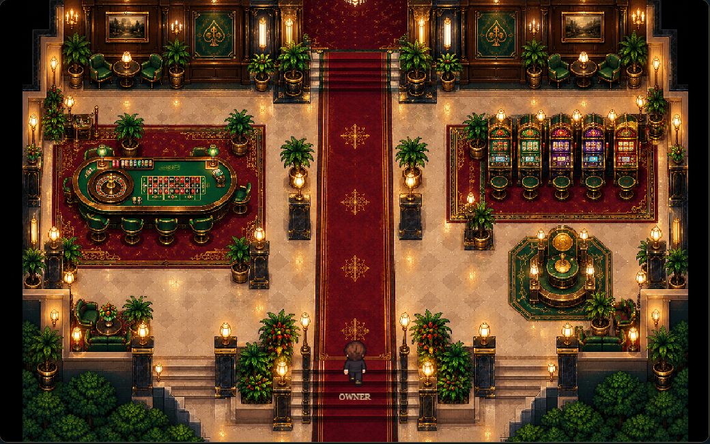

# Phase 6A — Main Casino Floor

The owner world now follows **Central Lobby ↔ Main Casino Floor ↔ Blackjack
Lounge**, with explicit E/button doors, adjacent-room Escape/toolbar returns,
and the existing standalone `floor/index.html` lounge still available. This phase
adds navigation and environment only. Existing blackjack remains authoritative.

## Architecture and file inventory

Added runtime files:

- `world/main-casino-scene.js`: `MainCasinoFloorScene extends ExplorableScene`,
  guarded image loading, shared owner/interaction setup, contact correction,
  masked foregrounds, debug drawing and shutdown cleanup.
- `world/main-casino-layout.js`: source-space primitives, transformed collision
  bodies, portals, safe spawns, approach guides, foregrounds and metadata anchors.
- `world/main-casino-config.js`: room dimensions and the existing speed/radius.
- `world/room-routes.js`: six directed edges, room labels/parents and validated
  arrival positions. Pure configuration; no scene or state-engine imports.
- `world/assets/casino/main-casino-floor.png`: exact supplied 1536×1024 image.

Modified runtime files: `world/main.js` registers rooms, stages travel, restores
safe entries, tracks transient departure diagnostics, supplies contextual labels
and exposes debug snapshots; `world/interactables.js` connects the lobby stair
to Main and declares its two doors; `world/dialogue.js` describes the longer route.
No shared owner, collision algorithm, lounge scene/host, guest controller,
reception queue, hotel engine, wallet or minigame implementation was changed.

Added tests: `main-casino-geometry`, `main-casino-transitions`,
`main-casino-lifecycle`, `main-casino-capture`, plus
`tests/helpers/main-casino-world.js`. Existing route tests in blackjack-bridge,
dealer-npc, guest-dialogue, guest-journey, guest-traffic, interactions,
lounge-visual, owner-sprite, reception-queue, receptionist-sprite, resort-lobby
and world now traverse Main using actual input. Their save, hand, financial,
collision and guest assertions are retained. Separate preflight readiness fixes
in `tests/helpers/guest-world.js` and `tests/management-guest-integration.spec.js`
foreground the guest test browser and allow the actual management test's initial
traffic wait to use 15 seconds rather than five wall-clock seconds.

Documentation/evidence: this report, the original `PHASE_6A_PLAN.md`, its geometry
and baseline JSON files, README, final verification JSON and Main screenshots/video.
Earlier uncommitted work and evidence remain in place.

## Artwork, geometry and controls

The image is 3,362,962 bytes; SHA-256
`143498d10180471a83e1a7eef4bbf89dc40fe7bc45f3f2e7011932fc85e6ca0b`.
It is copied unchanged from the supplied attachment. The scene rejects missing,
undecodable or incorrectly sized art before creating an owner. It creates no
substitute image and does not replace saved data on failure.

All three rooms render 1536×1024 art at (30,0), 900×600, in a 960×600 logical
canvas. Source conversion is `x=30+sourceX*75/128`, `y=sourceY*75/128`.
Nearest filtering, FIT canvas scaling, the original 48×72 owner frames,
radius 14, speed 190, normalized diagonal movement and feet anchoring are retained.
The red-carpet centerline is x=480 in each room. Lobby north stairs connect to
Main south stairs; Main north stairs connect to the lounge's existing south entry.
The connection uses scene cuts, not continuous scrolling or repainted edge seams.

| Main portal | Source rectangle (left,top,right,bottom) | Logical center | Size | Reach |
| --- | --- | --- | --- | --- |
| South → Lobby | 712,950,824,1004 | 480,572.4609375 | 65.625×31.640625 | 18 |
| North → Lounge | 712,112,824,148 | 480,76.171875 | 65.625×21.09375 | 18 |

| Arrival/approach | Logical body center | Facing |
| --- | --- | --- |
| From Lobby | 480,508.59375 | Up |
| South eligible approach | 480,544.921875 | Down when walking south |
| From Lounge | 480,140.625 | Down |
| North eligible approach | 480,103.125 | Up when walking north |
| Cold lounge entry | 480,480 | Up |
| Lounge exit center | 480,535; reach 44 | Existing behavior |
| Return to Lobby | Exact lobby departure checkpoint | Exact departure facing |

Main always uses the directional safe spawn. The lounge preserves its established
safe remembered pose on warm re-entry, including a pose at the blackjack table;
a remembered pose within its exit radius instead uses the safe cold-entry spawn.
Hotel preview pose memory is retained. This refinement preserves prior hand and
owner-facing behavior while keeping reverse doorway arrival safe.

There are 51 source primitives plus two logical black-margin guards, producing
120 static bodies. Walls/side returns, four central columns, south planters,
roulette/table stools, five cabinets and stools, coin plinth, sofas and pots have
separate footprints. Rounded table/plinth polygons use existing `polygonStrips`;
circles retain fractional extents. Existing swept-footprint correction runs after
Arcade contacts, without changing the shared collision implementation.

The central route and five approach guides are tested with radius 14.25. All
spawns, doors and future anchors share the south spawn's connected component.
Side passages can be single-file; paired NPC passing is not promised by 6A.
Roulette (208.125,342.1875), slots (761.25,292.96875), and coin kiosk
(655.78125,377.34375) are metadata only, with no registered interaction or game.

Foreground copies of the same PNG use source-space silhouette masks for the
roulette rail, stools, cabinets, coin sculpture, columns, roulette-side lamp and
palms. Their depth
crosses the owner at the relevant feet baseline. Mask graphics/masks and contact/
postupdate listeners are removed on shutdown. Scenes sleep/wake for ordinary travel.
Debug (`?debug=1`, Toggle collision debug; `&collisions=1` starts visible) shows
120 bodies, portal eligibility, safe spawns, owner circle, approach guides and
future anchors. `CasinoWorldDebug.snapshot()` adds artwork, geometry, foreground,
resource, room lifecycle and transient departure information.

## Navigation, saves and integrity

The world host resolves actions through directed edges rather than trusting a
definition's destination string. It validates the entry before sleeping the
source, stops movement, retains the lobby checkpoint, stages first creation or
wakes the existing scene, restores the entry and then focuses input. Repeated/
held E cannot chain rooms: the existing 250 ms lock is retained and a release is
required after a keyboard transition. Pointer activation uses the same dispatcher.

Escape/toolbar from lounge returns to Main, then from Main to Lobby; hotel still
returns to Lobby. Blackjack/dialogue keep their existing close-first behavior.
M and the management link use the original full-page Hotel Management UI.
The world host contextualizes the lounge's retained `lobby` interaction ID;
standalone lounge access does not gain a route into an absent world scene.

`casinoWorldState` remains version 2, `luxury-lobby-1`, with only the lobby pose.
Main/lounges are transient; reload and Continue still resume the lobby checkpoint.
Unknown metadata, v1 migration receipts, corrupt-save preservation and cross-tab
compare-before-write protections remain unchanged. No schema migration, persisted
room ID, hotel initialization or hotel repair is introduced.

Lobby guests sleep with their original identities, queues, service/dialogue clocks
and movement progress; wake uses the existing Phase 5E refresh. The blackjack iframe
stays mounted, preserving an active same-page hand and settling through its existing
logic. Navigation neither refunds nor settles wagers. Leaving/reloading an unfinished
hand retains the existing loss/unload-warning behavior.

## Verification record

Focused checks: `npx playwright test tests/main-casino- --workers=1`.
Full desktop/mobile suite: `npx playwright test --workers=1`.

The original planning full run reported 671 passed / 1 mobile initial-arrival
timeout. Its unchanged isolated rerun passed. After the explicit foreground/
readiness correction, that mobile management case passed three consecutive runs.

A second full pre-implementation run began 2026-11-01T00:18:41.238Z and reported
671 passed / 1 failed, no skips/retries. The failed mobile reception-access case
was interrupted for approximately four hours (14,656,776 ms test duration), rather
than completing its nominal 30-second physics wait. All other cases passed. After
adding explicit foregrounding to its helper, its unchanged gameplay assertions
passed three consecutive isolated runs. This is an interrupted baseline plus
focused verification, not a claimed clean 672-pass full baseline.

Initial geometry gate: 8/8 desktop/mobile checks passed. Initial scene/navigation
checks passed all transitions, held E, reload and art-failure cases; two new test
assumptions were calibrated against actual stool contact and transition-lock timing.
Existing direct-lobby-to-lounge test assumptions were updated to traverse Main.

The broad integration calibration run completed 278 cases successfully and found
12 failures: six obsolete route/lock assumptions in both projects. After those
test routes were corrected, the focused acceptance run passed those legacy cases
and the other selected checks (50 passed), with four new-test setup failures.
The latter were a physical exit pressed before the 250 ms lock expired and a
corner-pressure start inside a stool footprint, each in both projects. Correcting
the driver readiness and choosing a clear starting point resolved them. A final
six-case desktop/mobile contact, foreground and both-door rerun passed without
failures. Visual review also added the roulette-side lamp silhouette mask.

Final single-worker suite: **716 passed, 0 failed, 0 skipped, 0 retries** in
**44 minutes 49 seconds**, starting 2026-11-01T05:37:53.813Z. Both preflight
problem cases also passed in this complete run; the mobile reception case took
7.8 seconds. The interrupted preflight is retained separately above.

| Coverage | Passed | Failed |
| --- | --- | --- |
| Desktop Chromium | 358 | 0 |
| Mobile Chromium / Pixel 5 emulation | 358 | 0 |
| New Phase 6A checks, included above | 44 | 0 |
| Deterministic 600-active-second traffic stress cases at caps 6/8, included above | 40 | 0 |
| Genuine management UI / Main-to-management return checks, included above | 8 | 0 |

The real-UI scenarios verify a Rooms purchase updating a retained lobby without
replacing its guest, staff Rest preserving an active six-second service while
the next guest gets twelve seconds, and an actual Eli lobby assignment producing
thin coverage on full-page return. Main's M navigation independently verifies
the original management page and unchanged world checkpoint on return. These
tests distinguish authorized management-UI saves from the visual integration's
zero hotel/financial writes. Same-page blackjack hand retention, one settlement,
hard-reload wager loss, standalone lounge access, corrupt saves, migrations and
cross-tab protection all passed in the full suite.

[Machine-readable verification](PHASE_6A_VERIFICATION.json) contains per-file
regression totals, the 44 new cases, stress/UI outcomes, asset hash and file audits.

Independent hotel audits retain exact outputs across 1,795 selector fixtures and
48 room capacities, plus 360 financial fixtures; both report zero writes.
All 113 Phase 5E protected core-file hashes remain unchanged at the implementation
audit. Final byte and test results are included in `PHASE_6A_VERIFICATION.json`.
The starting-file audit found 305/323 byte-identical files; all 18 changed starting
files are the intended navigation/dialogue/test/README changes. A separate
241-file application/test manifest froze the final suite's source inputs; all
241 remained byte-identical throughout that run. There were no unexpected changes.

## Visual evidence

[Recorded keyboard/button tour](recordings/main-casino-floor.webm) visits both
connections and all three side approaches in the running game. It uses isolated
saved-resort test data; no owner teleport or alternate navigation route is used.

| Review | Evidence |
| --- | --- |
| Lobby stairs → Main | [Lobby departure](screenshots/main-casino-lobby-stairs.png), [Main south arrival](screenshots/main-casino-south-arrival.png) |
| Main → Lounge → Main | [Lounge arrival](screenshots/main-casino-lounge-arrival.png), [Main north arrival](screenshots/main-casino-north-arrival.png) |
| South return | [Main exit approach](screenshots/main-casino-south-exit.png) |
| Side circulation | [Roulette](screenshots/main-casino-roulette.png), [slots](screenshots/main-casino-slots.png), [coin kiosk](screenshots/main-casino-coin.png) |
| Debug geometry | [Bodies, doors, spawns and guides](screenshots/main-casino-debug.png) |
| Mobile layout | [Roulette](screenshots/main-casino-mobile-roulette.png), [slots](screenshots/main-casino-mobile-slots.png), [coin kiosk](screenshots/main-casino-mobile-coin.png), [debug](screenshots/main-casino-mobile-debug.png) |
| Foreground depth | [Roulette behind](screenshots/main-casino-roulette-rail-behind.png) / [front](screenshots/main-casino-roulette-rail-front.png), [cabinet behind](screenshots/main-casino-cabinet-2-behind.png) / [front](screenshots/main-casino-cabinet-2-front.png), [coin behind](screenshots/main-casino-coin-sculpture-behind.png) / [front](screenshots/main-casino-coin-sculpture-front.png), [lamp behind](screenshots/main-casino-roulette-east-lamp-behind.png) / [front](screenshots/main-casino-roulette-east-lamp-front.png) |

## Scope and remaining limitations

- Roulette, slots and the coin kiosk are scenery. Their existing standalone games
  remain available through Classic Casino Games; floor integration is Phase 6B.
- No casino NPCs, reservations, queues or schedules are instantiated. Phase 5
  lobby guests retain their existing visual journeys; casino traffic is Phase 6C.
- Active interior-room continuation is intentionally not persisted. Continue and
  hard reload return to the existing lobby checkpoint under schema 2.
- Collision/depth masks approximate the painted silhouettes. They establish
  owner circulation, not a guarantee for future NPC crowds or every sprite size.
- The standalone lounge keeps its original host behavior, rather than becoming a
  second entry point into the expanded world navigation graph.
- Mobile automation uses Chromium Pixel 5 emulation; physical-device performance
  profiling is outside this verification run.
