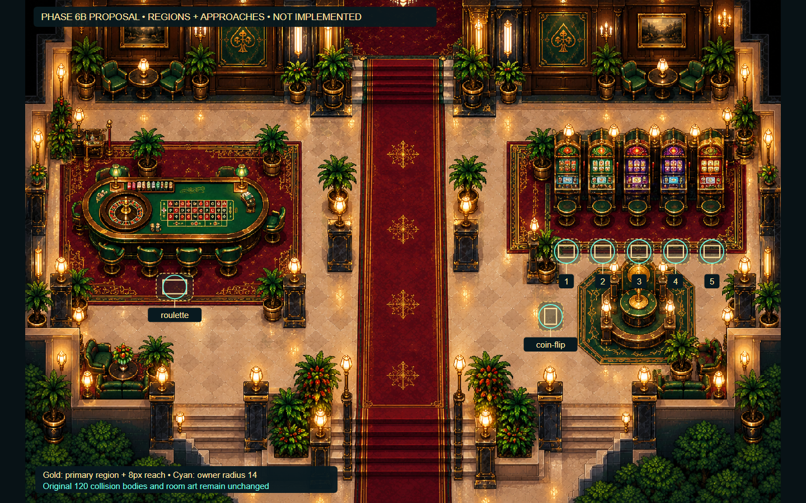

# Phase 6B — existing-game integration proposal

**Status: approved by the user's “implement 6B” instruction.**
This document preserves the preimplementation 6B.1 audit and approved proposal.
Statements below about unchanged files and absent hosting describe that planning
snapshot. Current implementation and verification are recorded in
[the implementation report](PHASE_6B_IMPLEMENTATION.md).

Starting checkout: `main`, commit `38b3117cc938ea43ab1695ea54a5ba983ea6c680`.
The working tree was clean. Hashes of all 361 starting files were captured before
the audit. The fresh single-worker baseline passed **716/716** (358 desktop,
358 mobile), with no skips or retries. All 361 starting files remain byte-identical.
Six additional isolated existing-page audit observations completed; their scope
and concrete findings are recorded below. No Phase 6B host is installed.

## 1. Actual game entry points and authority

| Game | Existing entry and implementation | Initialization / embedding today |
| --- | --- | --- |
| Roulette Royale | `roulette/index.html`, `roulette/script.js`, `roulette/styles.css` | Classic script immediately calls `CasinoShell.mount`, builds wheel/numbers and applies the existing hotel gate. No host-ready/close/round contract yet. |
| Lucky Reels | `slots/index.html`, `slots/script.js`, `slots/styles.css` | Classic script registers `DOMContentLoaded`, then mounts the shell, initializes reels, applies hotel limits and wires controls/shortcuts. Local `vendor/gsap-3.9.1.min.js`; a timeout fallback exists if GSAP is unavailable. No embed contract yet. |
| Coin Flip | `coinflip/index.html`, `coinflip/game.js`, `coinflip/styles.css` | Immediately mounts shell, wires betting/ride/cash-out buttons and renders the default bet. CSS coin animation plus a settlement timeout; no GSAP requirement. No embed contract yet. |
| Blackjack X | `blackjack/index.html`, `blackjack/script.js`, `blackjack/floor-bridge.js`, `blackjack/floor-embed.css` | `DOMContentLoaded` mounts shell, configures chips and enters betting. Already hosted at `?embed=floor` by `floor/blackjack-overlay.js`, shared by world and standalone lounge. |

All four pages load `save-safety.js`, `wallet.js`, `casino-shell.js`,
`hotel-events.js` and `hotel-perks.js`. All have `safe-storage.js` (Slots loads it
in the head). Game assets/scripts are same-origin, with no source-declared
frame-blocking CSP. Relative URLs and existing responsive CSS permit a same-origin
iframe; the first three need a verified optional bridge before they are safe
world-hosted experiences. Bare-page compatibility is distinct from a completed
production host.

Each game uses `CasinoShell.wallet`; Slots additionally falls back to
`window.CasinoWallet`. The existing wallet reads `casinoBalance` on each operation,
writes through its current `set/add/deduct`, emits `wallet:change` in its own
document, and observes other documents through the `storage` event. Do not replace
or wrap payout calculations. The world already subscribes once through
`CasinoWallet.onChange`; a child's balance write should update that subscription
via same-origin storage events. Confirm this with actual embedded wagers.

The shell also awards wager XP and existing level-up chip bonuses. Daily bonuses
and Cashier/comps are explicit existing user actions, not host rewards. Mounting
a game does not place a wager or automatically claim a bonus. First-use shell
welcome UI and Slots' `slotToastShown` write remain existing cosmetic behavior.
Hotel perks are read-only here; actual wager/events enqueue existing
`hotelEventQueue` entries. The host must neither consume that queue nor write
`hotelGameState`, `hotelGuestPool` or management calculations.

### Roulette lifecycle

- `bets`/`lastBets` are in-memory selections. Placing chips and Rebet do **not**
  deduct; `spin()` sets `spinning=true`, deducts the aggregate stake once, awards
  existing XP and queues `chips_wagered`.
- The original uniform `Math.random` result and existing `betSpec`/`settle`
  calculations remain untouched. `settle` returns winning stakes and payouts via
  the wallet, updates the 12-result in-memory history, clears `bets`, then sets
  `spinning=false`. Losses were already charged at spin start.
- Settlement waits 3,300 ms normally or 150 ms with reduced motion. No visibility
  pause or unfinished-round persistence exists. A mounted hidden document can
  continue timers, subject to browser throttling; unloading it can cancel its
  pending settlement after deduction.
- Hard reload loses an unresolved spin and transient selections/history; it does
  not undo the saved deduction. An idle unpaid selection may be discarded safely.
- Existing gate is Casino Floor level 2 and reputation 5. Keep that gate and its
  lock screen. Production embedding must not add `dev=1` or force an unlock.

### Slots lifecycle

- `spin()` sets `spinning=true`, deducts one `currentBet`, grants original XP and
  queues `slots_spun`/`chips_wagered`. Three original reel promises select symbols
  and settle via GSAP callbacks or fallback timeouts.
- `Promise.all` sets `spinning=false`, records history, computes winnings with the
  existing `calculateWinnings`, and credits the wallet in the **same JS task**.
  Presentation/typewriter work can continue after financial settlement.
- `auto` remains non-null across spins and pauses. A typewriter completion can
  call `continueAuto`, which schedules another paid spin 600 ms later (250 ms
  reduced motion). Thus `!spinning` alone is **not** safe to close. Existing
  Stop/Space/Escape calls `stopAuto`; do not synthesize financial actions.
- There is no visibility handler or round persistence. Hiding a live auto-spin
  document risks additional hidden wagers; unloading mid-spin can cancel required
  reel completion/payout. Do neither during a paid spin or active auto run.
- The ten-row spin history and auto state are document-local. Closing a safe
  embedded visit will discard that transient history, just as a standalone page
  unload does. No cabinet-specific history/engine/wallet will be introduced.

### Coin Flip lifecycle

- Initial `flip` deducts `bet` once and grants XP. Riding stakes the existing
  in-memory `pot` rather than making another wallet deduction.
- `flipping=true` covers the 850 ms outcome timer (120 ms reduced motion).
  Winning sets/doubles `pot`; it does **not** immediately add that pot to the
  wallet. A stopped animation can therefore still hold unsettled money.
- The existing Cash out button invokes `cashOut`, which adds the full pot once
  and clears `pot`/`rides`. A loss clears them without another deduction. The
  existing final-ride limit auto-cashes through that same function.
- The game has `pagehide`: it calls its own quiet cash-out **only if**
  `pot && !flipping`. This is not permission for the host to bank money, nor a
  guarantee for iframe removal, a browser crash, or a mid-flip unload.
- Hard reload during a fresh flip can lose the pending result after deduction;
  during a ride it can lose the unbanked pot. Idle-pot pagehide banking is an
  existing game behavior that must be tested separately from ordinary host close.

### Blackjack lifecycle to preserve

- `phase` (`betting`/`playing`/`resolved`), `busy`, `gameActive`, hands and insurance
  describe the round. `body.mid-hand` is the current host's leave-warning signal.
  Deal, double, split and insurance deduct through the existing wallet; guarded
  `finish()` pays once and records its in-memory Recent Hands.
- The current source uses a local 52-card Fisher–Yates shuffle, not a remote deck
  dependency. Do not replace it or its controlled test-deck helpers.
- Closing its existing overlay keeps the same iframe mounted, including an
  unresolved hand. Timed dealing/dealer work can continue; a player decision can
  wait until reopening. Same-page state survives room trips.
- The world warns before leaving/reloading an unfinished hand. Reload still loses
  the in-memory hand with its saved wager deducted. Keep that contract, dealer
  behavior, standalone `floor/index.html` and standalone blackjack page.

All pages already have shell Casino Floor/Hotel links; these currently navigate
the document. Only Blackjack has a bridge converting them into host-close
requests. The other three need guarded embedded navigation interception.
Loading scripts twice or keeping five Slots iframes would duplicate initialization,
callbacks and independent transient histories. The proposed host prevents this.

## 2. Financial integration risks and proposed compatibility changes

**Cached profile data can duplicate level rewards.** `casino-shell.js` loads its
private profile once at setup. `awardXp` uses that cached XP; it does not reload on
other-document profile writes. Multiple retained game documents can consequently
overwrite newer XP and cross the same bonus threshold twice. Keeping the current
Blackjack iframe means this must be handled even if new game frames are ephemeral.

Proposed narrow remedy: expose a read-only `CasinoShell.refreshProfile()` that
uses the existing validation, `profile.load()` and progression rendering. Call it
when activating an embedded document, before releasing game inputs.
On refresh, rebuild only the in-memory default profile before loading, so a
legitimately absent optional field does not retain an older document's value;
this matches fresh-page defaults without saving, migrating or repairing data.
New Main
Floor documents are freshly created; on every Blackjack reopen, send its existing
host-ready probe and refresh in the existing bridge before ready/focus. Keep the
retained iframe inert for that activation until its fresh ready reply, preventing
a click from racing profile synchronization. Do not
change XP formulas, level thresholds, bonus amounts, `awardXp`, betting or wallet
operations. This is a profile synchronization method, not a new wallet API.
Tests must alternate Slots/Roulette/Coin and an active retained Blackjack hand
around a level boundary and assert cumulative XP and each original reward once.

**Storage fallback is document-local.** `safe-storage.js` can keep failed writes
in a per-document memory store. Treat a nonpersistent child or parent/child wallet
disagreement as an unavailable shared-wallet condition: block new paid inputs,
show the actual error, retain any already-paid document, and never reconcile by
setting balances or refunding from the host. Check readiness before enabling play;
observe storage-unavailable events thereafter. Verify quota/blocked-storage cases
before declaring embedded financial integrity. No second in-memory world wallet,
automatic balance copy, or save repair is proposed. An external quota failure
mid-settlement cannot be turned into a durable transaction without a separate
wallet/persistence design; preserve the document and report this limitation.

**Other unload paths require protection.** Embedded shell navigation, Save import
(which rewrites saved data and reloads), and browser navigation can bypass an
ordinary close button. New embed mode will hide/disable save import and its
navigation chrome while preserving gameplay, help, sound/theme, Cashier and
explicit daily-bonus operations. Intercept remaining links through the close
guard; external feedback may open separately without unloading the game. The
existing Blackjack save/import behavior is a pre-existing boundary: do not expand
6B into its persistence rewrite; warn/document it and retain current save-conflict
protection. Test ordinary world leave controls and forced reload separately.
Casino-return links request the guarded Main-floor return. If an original Hotel
CTA is retained (notably locked Roulette), it may invoke only the existing
full-page management link after safe closure and the existing Blackjack leave
warning. Ordinary Return never travels to another room or opens management.

## 3. Exact proposed attraction geometry

The original clean 1536×1024 Main Floor PNG and all 120 bodies/masks remain
unchanged. `toWorld(x,y)=(30+x*75/128,y*75/128)`. Bounds below are source-space
left/top/right/bottom; logical positions describe the owner body center. Every
region has **8 logical pixels** of extra interaction reach.

| ID / prompt | Source rectangle | Logical center and standing position | Logical width × height |
| --- | --- | --- | --- |
| `roulette` · Play Roulette Royale | 280,570,328,598 | 208.125,342.1875 | 28.125 × 16.40625 |
| `slot-1` · Play Lucky Reels · Machine 1 | 1084,500,1116,524 | 674.53125,300 | 18.75 × 14.0625 |
| `slot-2` · Play Lucky Reels · Machine 2 | 1158,500,1190,524 | 717.890625,300 | 18.75 × 14.0625 |
| `slot-3` · Play Lucky Reels · Machine 3 | 1232,500,1264,524 | 761.25,300 | 18.75 × 14.0625 |
| `slot-4` · Play Lucky Reels · Machine 4 | 1306,500,1338,524 | 804.609375,300 | 18.75 × 14.0625 |
| `slot-5` · Play Lucky Reels · Machine 5 | 1380,500,1412,524 | 847.96875,300 | 18.75 × 14.0625 |
| `coin-flip` · Play Coin Flip | 1056,628,1080,660 | 655.78125,377.34375 | 14.0625 × 18.75 |

Slots are numbered left-to-right. Standing south of each stool at y=300 gives a
clear approach without changing stool/cabinet bodies. Roulette is approached from
the south; Coin Flip from its west side. All five Slots IDs map to the same
`gameId:'slots'`, URL and engine, with no machine-specific money or saved history.
The owner may face the attraction naturally; opening/closing preserves the actual
facing rather than forcibly rotating it.

The [editable diagram](phase6b-attractions-plan.svg) annotates the unchanged art.
The planning-only [geometry checks](phase6b-interactions-proposal.json) verify all
seven positions with radius 14.25 and a connected component of 11,937 grid nodes.
Adjacent slot eligibility envelopes have 8.609375 logical pixels of separation,
not merely non-overlapping primary rectangles. Neither doorway approach is in an
attraction range. Opposite-side roulette/cabinet/kiosk examples are walkable but
outside range and obstructed from the standing point. These are numerical checks,
not claims that runtime E prompts or hosted games already exist.

At runtime add an optional per-definition reachability predicate to the existing
pure selector. Only new attractions use it: require Main room, a walkable owner
circle and a radius-14 clear segment to that attraction's standing point. Do not
replace pathfinding or accept a range through an obstacle. Existing definitions
retain their exact selection behavior. After filtering, retain distance then
stable ID tie-breaking. Door regions remain spatially separate; do not globally
reorder existing NPC/dialogue/door priorities. Re-evaluate on activation, reject
repeats and let a single dispatcher open at most one host.

Add optional debug rectangles, expanded eligibility, standing circles, IDs and
the selected clear segment. No debugging control can set balances or outcomes.

## 4. Shared host and child bridge

Create one `CasinoGameHost` for Main's three games, with a fixed registry of
same-origin entry URLs. It owns one native dialog and **at most one active iframe**.
Reuse the existing Blackjack overlay's native-modal, authenticated-message,
inert-until-ready and immediate pause/resume patterns. Keep Blackjack's host as
the existing single retained host; its different hand policy does not justify a
risky base-class rewrite.

Proposed Main URLs: `roulette/index.html?embed=casino`,
`slots/index.html?embed=casino`, `coinflip/index.html?embed=casino`.
One shared optional classic-script bridge is included after each original game
script. It activates only with the query flag and a verified same-origin world
parent; standalone pages retain their current initialization and interface.
Small per-game readers observe original lexical state; they never calculate a
result, call `add/deduct`, or invoke a refund/settlement.

Suggested host states: `closed → loading → ready/open → closing → closed`, with
`failed` and `pending-disposal` branches. Set the host blocked flag synchronously
before creating/loading the iframe, so two E/button events cannot launch two games.
Readiness verifies the expected game DOM, initialized shell, gate/error state and
shared storage; the iframe remains inert until that succeeds. A locked Roulette
screen is a valid original interface with no playable wager, not an unlock error.

Messages require exact origin, expected WindowProxy, whitelisted URL/game ID,
protocol version, visit/session nonce and request ID. Ignore stale/foreign ready,
state and close replies. A load event alone does not prove the game initialized.
HTTP(S) is the primary target. Local-file support must match Blackjack's exact
readable-path/WindowProxy checks; otherwise fail closed rather than accept an
arbitrary opaque origin.
A bounded timeout/load/decode/script failure before ready can remove an inert,
unplayed frame and restore the owner; never retry by reloading a previously paid
document. Once a paid state is possible, unknown/error state fails closed and
retains that document rather than assuming it settled.

For presentation use the established dark emerald/burgundy/gold native-dialog
style, title/status header and a mouse-accessible Return to Casino button outside
the iframe. Use a wide desktop dialog (target min(1200px,96vw), about 94dvh),
full-width mobile layout, a fixed readable header, and independently scrollable
game content. Preserve the original boards, controls, typography and responsive
layouts. Do not scale/crop the Roulette board to force it into a small viewport.
Test the full board, Slots controls/history/paytable and Coin's ride/cash-out panel.

## 5. Safe closure and input policy

| Game | Close authorization from original state | Player action while blocked |
| --- | --- | --- |
| Roulette | `!spinning` | Wait for original settlement. Unpaid selected chips do not lock return. |
| Slots | `!spinning && auto === null` | Stop Auto-spin using the original control, then let the current paid spin settle. Do not infer safety from disabled buttons or stopped reels. |
| Coin Flip | `!flipping && pot === 0` | Finish the flip and use the original Cash out button, or complete/lose the ride. The host never cashes out on the player's behalf. |
| Blackjack | Existing close-and-retain behavior | Continue the retained hand when reopening; no new closure restriction or settlement logic. |

The header status may show the latest observed state, but a cached `canClose`
message is not final authorization. Every close requests a **fresh** child check.
If safe, the bridge temporarily blocks new game input in that same event-loop
turn before acknowledging the exact request, eliminating a bet-start/close race.
The parent then removes the quiescent Main iframe and its timers/listeners, closes
the dialog and resumes the same Main scene. Repeated opens create a fresh original
document, with fresh shell/perks state; no unresolved document is replaced.

State notifications use original-state readers with bounded DOM/input observation;
they are diagnostic only. Read after game tasks/microtasks, so Slots' same-task
`spinning=false` and payout sequence cannot be split by a parent decision.
Do not modify random generation, timer settlement callbacks or round economics.

Escape inside a shell help/Cashier/bonus modal closes that inner modal first.
Slots' first Escape during auto-spin retains its original Stop behavior; another
close request still waits for the current paid spin. Because Slots registers an
Escape shortcut even when auto is null, the bridge must distinguish an actual
handled stop from that no-op rather than blindly treating `defaultPrevented` as
permanent refusal to return. Parent dialog cancel, header Return, child links and
child Escape all use the same fresh close guard. The world Esc handler is blocked.
Coalesce a child's Escape and the native parent-dialog cancel from the same key
press, so closing an inner modal cannot also close its host.

On open: snapshot exact `{scene,x,y,facing,attractionId}`, stop/reset owner keys,
pause the existing Main scene and suppress world actions. Focus the initialized
iframe at a safe non-betting target. On authorized close: restore the captured
pose in that same scene, reset keys, resume physics, refresh the existing HUD
through read-only wallet/resort getters, focus canvas and apply the existing
250 ms lock plus fresh-E-release rule. Never call room travel or generic spawns.

On ordinary controlled scene shutdown, request disposal through the same guard
before teardown. Idle disposal removes the overlay/frame and all listeners. If
an external shutdown arrives while paid state is unresolved, do not resume a
destroyed owner or discard the independent game document: keep it available to
settle/cash out, then finish pending disposal. Test deferred disposal explicitly.
Forced browser unload remains the separate limitation below.

## 6. Reload, storage and integrity boundaries

The Main host warns on leaving/reloading during an unresolved new-game state,
alongside the existing Blackjack warning, but the browser can still force unload.
At beforeunload, synchronously query the verified child's read-only state reader
and treat unknown active state conservatively; do not rely on a delayed cached
round-state message to decide whether to warn.
No new persisted rounds or schema migrations are proposed. World version 2 and
the lobby checkpoint contract remain unchanged.

- Forced Roulette/Slots reload can lose a pending payout after the original
  deduction. The host does not refund or replay it.
- Forced Coin reload during flipping can lose the pending result/ride pot; an
  idle pot may be banked by the original `pagehide` callback when delivered.
  Test both instead of promising crash recovery.
- Blackjack keeps its current hard-reload limitation and retained same-page hand.
- Storage failures/foreign-tab simultaneous gambling retain underlying localStorage
  transaction limitations. Phase 6B will not claim atomic multi-tab wagering or
  add a new ledger. Guard degraded storage and preserve evidence/documents.
- New embedded save import is disabled because it reloads/replaces unrelated
  saves. Standalone save/import remains available and unchanged.

Opening a host itself must leave chips unchanged. A wager may legitimately write
chips, profile XP/level rewards, cosmetic flags and the existing hotel event queue.
These writes must be distinguished from prohibited host hotel/guest-state writes.
Use only the single existing parent wallet subscription; do not add an
unsubscribable `CasinoWallet.onChange` per visit. Child subscriptions disappear
with a safely destroyed document. Read authoritative balance on return as a
timing safeguard, without copying or setting it.

## 7. Proposed file scope

Create:

- `world/casino-attractions.js`: seven source-aligned regions, prompts,
  standing points and pure reachability data; imports unchanged Main geometry.
- `world/casino-game-host.js`: one Main dialog lifecycle and validated protocol.
- `casino-game-bridge.js`: optional shared child lifecycle/input/navigation bridge
  with small Roulette/Slots/Coin state readers.
- `casino-game-embed.css`: embed-only chrome/scroll adjustments; no game redesign.
- Focused tests: attraction geometry, host lifecycle, actual wagers, storage/profile
  integrity and a recorded Main Floor/game/Blackjack tour; reuse existing helpers.

Modify narrowly after approval:

- `world/interactables.js`, `world/interaction-system.js`: typed game actions and
  opt-in reachability; existing definitions retain old semantics.
- `world/main-casino-scene.js`: attraction halos/debug bounds and diagnostic data.
- `world/main.js`: one Main host, modal blocking, captured-pose resume, shared leave
  guard and read-only diagnostics/HUD refresh.
- `world/index.html`, `world/world.css`: native dialog/header and responsive styles.
- `world/room-routes.js`: help text only if needed; six edges/entries untouched.
- The three existing game HTML pages: optional bridge/CSS includes only.
- `casino-shell.js`: read-only profile refresh method, no financial formulas.
- `floor/blackjack-overlay.js` and `blackjack/floor-bridge.js`: refresh/handshake
  on every activation, without reinitializing the table or changing hand logic.
- Existing tests only where scenery-only prompt assertions need updating; preserve
  all existing financial, scene, guest and save assertions. README and final report.

Protect unchanged: all three minigame implementation scripts and payout/random
functions; `wallet.js`; Blackjack game/dealer/deck logic; hotel engine/state/perks/
events; world-state v2; owner controller/sprite; room geometry/config and PNGs;
foreground masks; NPC movement/pathfinding/queues/personality/activity modules.
No casino NPCs, casino revenue simulation, new mechanics, elevators, rooms or wing.

## 8. Milestones and acceptance gates after approval

1. **6B.1 audit (this deliverable):** entry/lifecycle/authority findings, fresh
   baseline, exact numerical geometry and explicit integration risks.
2. **6B.2 interactions:** add seven definitions/reachability and debug bounds;
   actual keyboard walk to all five cabinets, range/obstacle/door/tie/repeat tests;
   verify unchanged collision, PNG, owner and route hashes before continuing.
3. **6B.3 shared host:** loading/ready/error/close guard protocol, native focus,
   pose capture, key release and bounded cleanup. Use lifecycle test documents
   without pretending these are the actual game-integrity tests.
4. **6B.4 actual games:** optional bridges, original gates/interfaces, genuine
   paid rounds, wallet/HUD propagation and profile refresh. Verify one instance
   across Machine 1/5, losses/wins once, no auto-bet, level reward exactly once.
5. **6B.5 return/lifecycle:** mid-spin/mid-pot/auto/inner-modal Escape, fresh close
   races, deferred disposal, repeated opens, existing retained Blackjack hand and
   full Lobby ↔ Main ↔ Lounge route. Check hotel/guest/checkpoint bytes and listener
   balances before continuing.
6. **6B.6 regression/polish:** complete single-worker desktop/mobile suite, focused
   degraded-storage/corrupt-save/reload tests, screenshots and recordings using
   real game UI and isolated data. Document any genuine failure separately from
   environment interruption; preserve previous evidence.

Deterministic fixtures will use existing test patterns: controlled Roulette RNG,
Slots' original reel-symbol seam and Blackjack deck helper, with original outcome
calculations intact. Seed balances only to establish isolated starting data; prove
results via actual bets/buttons, transaction counts, history/XP and final balances,
never artificial post-wager balance changes. Test Coin's delayed pot and a loss,
Slots partial/push/loss/jackpot/auto cases, Roulette win/loss, and cross-game
level-boundary progression separately from ordinary wager returns.

Capture: approach/prompt/open/paid result/exact return for Roulette, Slots and Coin;
Machine 1 and Machine 5 launching the same implementation; normal and debug room
views; Blackjack still playable and the complete room route. Mobile emulation
must keep the betting board, spin/stop and cash-out controls reachable by scrolling.

Debug additions are read-only: current room, nearest valid attraction/ID/range/
standing point, host state, active game, load/ready status, owner focus/input,
observed round/auto/pot-pending booleans and safe-close state, live/created/destroyed
frame counts, listener cleanup counters and existing route diagnostics. Expose
no result injection, payout controls or hidden outcome values in production.

## 9. Verification record

The [fresh baseline record](phase6b-baseline.json) reports:

- 716 passed: 358 desktop Chromium and 358 mobile Chromium.
- One worker; no failures, skips, retries, flakes or global report errors.
- Duration 46 minutes 8 seconds, starting 2026-11-01T15:33:56.206Z.
- All 361 starting application/test/artwork/evidence files byte-identical.
  Only new planning documentation and ignored audit artifacts were created.

After that suite completed, six **desktop-only existing-page probes** ran
sequentially in isolated browser data, without editing game scripts. These are
compatibility/risk observations, not successful implementation of this proposal.
The [machine-readable audit](phase6b-game-audit.json) retains observed state and
wallet events. No financial result was demonstrated by setting a post-wager balance.

| Original game UI action | Observed authoritative result |
| --- | --- |
| Open each original game in a bare same-origin iframe | All three initialized; opening left the starting 250.25 chips unchanged. This probe did not install a world game host. |
| Roulette: $5 straight bet on controlled result 17 | Existing game returned $180; wallet and world HUD became 425.25. |
| Slots: $0.60 spin, controlled triple cherries | Existing game returned $1.20; wallet and world HUD became 250.85. |
| Coin Flip: $5 Heads win, then original Cash out button | Wallet remained 245.25 while the $10 pot was pending, then became 255.25 on Cash out. |
| Remove those three documents after each round/cash-out | No additional credit; hotel and guest-save bytes remained unchanged. |

The probes also confirmed the specific risks motivating the close/profile design:

1. **Stale cached Blackjack profile:** start both documents at XP 49. Roulette's
   actual $1 winning round legitimately crossed to XP 50 and awarded the existing
   level bonus, leaving 301.25 chips. Retained Blackjack still reported XP 49.
   Its next actual $1 Deal emitted wallet values **300.25 then 350.25** and saved
   XP 50 again: a duplicate $50 bonus and lost XP progress. This demonstrates a
   pre-existing cached-profile limitation exposed by the proposed multi-game use,
   not a failure of an implemented 6B host. The proposed read-only activation
   refresh must resolve this before accepting cross-game wager integrity.
2. **Hidden auto-spin:** with the existing reduced-motion option and controlled
   losing symbols, a retained `visibility:hidden` Slots iframe spent another
   **$1.80** over 2.4 seconds after the first $0.60 spin. Original Stop ended the
   run. Hiding a running auto document is therefore not a safe return strategy.
3. **Coin idle-pot unload:** this Chromium run delivered `pagehide` on iframe
   removal and the original game banked the $10 pot (245.25 → 255.25). This proves
   the callback's current behavior in this probe, not a browser-crash guarantee;
   ordinary host return will require explicit original Cash out instead.

Existing-page screenshots: [Roulette](screenshots/phase6b-audit-roulette.png),
[Slots](screenshots/phase6b-audit-slots.png),
[Coin Flip](screenshots/phase6b-audit-coinflip.png). These are scrollable-viewport
excerpts of the original UIs in the compatibility harness, not the future Phase
6B overlay or acceptance tour.

**Approval requested for this concrete proposal before application changes.**
In particular, review the quiescent-close/document-release policy, Coin cash-out
requirement, Slots auto-stop requirement, small read-only profile refresh and
retained-Blackjack readiness guard. The plan does not authorize itself; 6B.2–6B.6
remain unimplemented until the user's review and approval.
